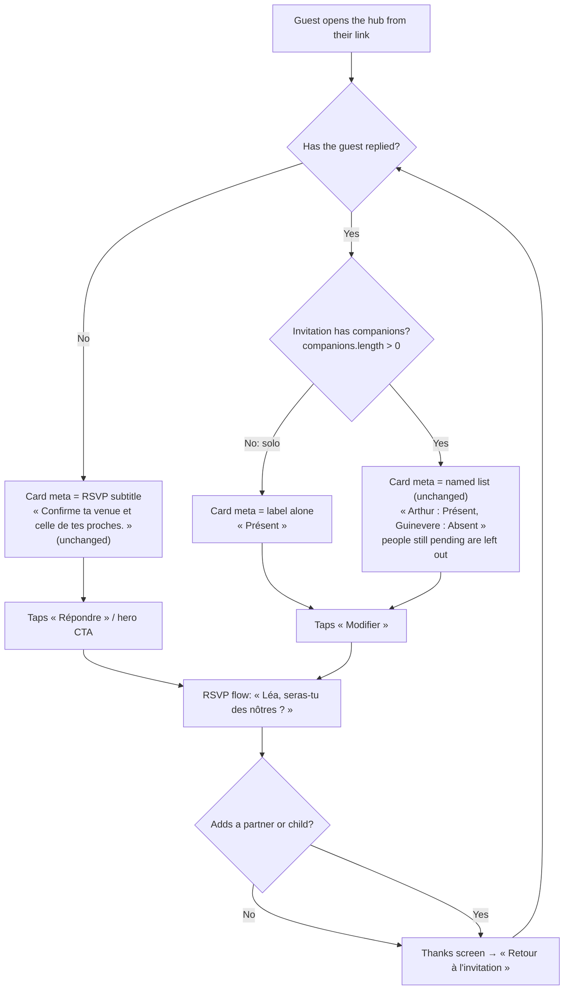

# Issue #85 — Design

Mode: spec. Scope as approved in `strategy.md` (verdict **go**, Arthur confirmed A1 and A2 in the issue comments). Prototype: `prototype.html` (same file as `apps/web/public/squad-proto/85.html`).

## Summary

On a **solo invitation** (no companions), the RSVP card in the hub's « Vos réponses » section shows **the answer label alone**: `Présent`, `Peut-être`, `Absent`, or the couple's own label as written (`Je ne pourrai pas venir`). No name, no colon. On an invitation **with companions**, the line stays exactly as it is today (`Arthur : Présent, Guinevere : Absent`).

The bare label is enough. No sentence is substituted, not even for Union's default labels (see "Decision D1": this answers strategy Q1 / R1).

## Assumptions

- **[Assumption] A-D1: the line stays a bare echo of the button the guest tapped.** The answer step of the RSVP flow shows the same three labels as choices ([Certain], `RsvpFlow.tsx:280-285` builds the choices from `labelAttending` / `labelMaybe` / `labelDeclined`, the same values `statusLabel` uses in `GuestPortal.tsx:306-309`). Showing the tapped word back is the plainest confirmation. Why it is an assumption: nobody has watched a guest read it. Arthur checks it on the preview.
- **[Assumption] A-D2: "solo" is read from the hub's live companion list**, not the invitation as loaded. `companions` is local state that grows when a partner or child is added during the RSVP ([Certain], `GuestPortal.tsx:133-135` and `:546`). So a guest who adds someone mid-RSVP sees the named format as soon as the flow closes, without reloading. This follows the strategy's reading (a).
- **[Assumption] A-D3: a guest cannot remove a companion from the hub.** [Likely] The only write to `companions` in the guest code is an append (`GuestPortal.tsx:546`). If the couple removes the last companion on their side, the next hub load is solo and shows the bare label. That is correct and needs no special handling.

## 3. Options

No benchmark file exists for this issue, so no real product is cited.

| | A. Bare label (recommended) | B. Tutoiement sentence for Union's default labels | C. Prefix « Ta réponse » |
|---|---|---|---|
| Solo, default labels, attending | `Présent` | `Tu seras des nôtres` | `Ta réponse : Présent` |
| Solo, couple's labels | `Je ne pourrai pas venir` | `Je ne pourrai pas venir` (the couple's words always win) | `Ta réponse : Je ne pourrai pas venir` |
| User value | Echoes the word the guest just tapped. Shortest. | Warmer, gender-neutral for the defaults. | Unambiguous whose answer it is. |
| Cost | One condition. | Needs to know whether each label is the couple's or Union's default: `rsvpWording` does not expose that today ([Certain], `lib/i18n/text.ts:65-86`), so new plumbing. Two rules for one line. | One condition plus one new string per locale. |
| Risk | R1: `Présent` may read as an adjective about a woman invited alone. | The card repeats the hero's script line word for word (`gh-replied`, `GuestPortal.tsx:458-461`): same sentence twice on one page. The line's voice changes depending on a setting the guest never sees. | Brings back a prefix, which is what the issue asks to remove. « Ta » clashes with a couple who writes in « vous » (« Votre présence » in the screenshot). |
| Reversible | Yes | Yes | Yes |

**Recommendation: A.** [Avis] It keeps one rule (drop the prefix), never touches the couple's wording, and the word on the card is the word on the button. R1 is not new: the masculine `Présent` is already shown today after the name, and the gendered defaults are out of scope ("Out" in `strategy.md`). B fixes R1 only for couples who kept the defaults, at the price of plumbing and a duplicated sentence. If Arthur reads `Présent` on the preview and it jars, the right fix is the default label itself (« Je serai là » or similar), in its own issue, because the same word is also the button in the flow.

## 4. Flow

Nothing new in the flow. The change is one line on one card. The flow below shows where the line is read and when it switches format.

Back / close: closing the RSVP flow without sending leaves the card as it was (unchanged behaviour, `RsvpFlow`). Browser back is unchanged.

## 5. Screens × states

Only one component changes: the RSVP card (`FormList` item with `key: "rsvp"`), its `meta` line. Everything else on the card (icon, title, « Complété », button) is unchanged.

| Card state | Solo invitation | Invitation with companions |
|---|---|---|
| Not replied, window open (`todo`) | Meta = RSVP subtitle. Button « Répondre ». **Unchanged.** | Same. **Unchanged.** |
| Replied, window open (`done`) | **Meta = label alone** (`Présent` / `Peut-être` / `Absent` / couple's label). « Complété ». Button « Modifier ». | Meta = `Prénom : Libellé` for each person answered for, joined by `, `. **Unchanged.** |
| Replied, window closed (`done`, no button) | **Meta = label alone.** « Complété ». No button. | Unchanged. |
| Not replied, window closed (`closed`) | Meta = subtitle. « Fermé ». Unchanged. | Unchanged. |
| Window not open yet (`soon`) | Meta = subtitle (a guest cannot have replied yet). Unchanged. | Unchanged. |
| RSVP hidden by the couple | No card. Unchanged. | Unchanged. |
| Loading | N/A: the hub renders server-side with the reply already in the props; the line is derived, never fetched. | N/A |
| Error | N/A for the line. A failed save is handled inside the RSVP flow (unchanged); the card keeps the previous answer. | N/A |
| Offline | N/A: same as error. The card shows the last answer the page knows. | N/A |
| Demo mode (`gh-demo` band) | Same rule as a real guest. | Same. |
| Link expired / wrong person | N/A: handled before the hub renders (entry gate); this line never shows. | N/A |

## 6. Edge cases

| Case | Expected line | Note |
|---|---|---|
| Solo, attending, default labels (fr) | `Présent` | |
| Solo, maybe, default labels (fr) | `Peut-être` | Only when the couple allows "maybe". |
| Solo, declined, couple's label (screenshot) | `Je ne pourrai pas venir` | The couple's wording, untouched. |
| Solo, en | `Attending` / `Not sure yet` / `Declined` | Same rule in both locales. |
| Solo, stored "maybe" that the couple no longer accepts | `Peut-être` (or the couple's maybe label) | Same as today minus the name; the flow already asks for a firm answer. |
| Solo guest adds a partner during the RSVP, both answer | `Léa : Présent, Hugo : Présent` | The invitation is no longer solo (A-D2). Switches without reload. |
| Solo guest adds a child, child not answered for yet | `Léa : Présent` | Has companions: name kept (strategy, reading a). |
| Companions, only the guest answered | `Arthur : Présent` | Name kept on purpose: the answer is only his. |
| Household of 12, all answered | 12 `Prénom : Libellé` pairs, wraps over several lines | Unchanged. Wraps, no truncation. |
| Very long couple label (« Je ne pourrai malheureusement pas être des vôtres ce jour-là ») | Wraps on two or three lines, no ellipsis | `.gh-task-text` has `min-width:0`; at 390 px, under 480 px the button moves under the text, so the meta has the full card width. Verified in the prototype. |
| Long first name (« Marie-Bénédicte-Alexandrine ») | Solo: not shown on the card at all. Household: unchanged. | |
| Guest first name empty in the data | Solo: `Présent` (today it renders ` : Présent`). | [Certain] the current code would output a leading separator; the fix removes it for solo. Households keep today's behaviour. |
| Couple label is blank | Union's default label | Already handled by `coupleTextOr` ([Certain], `text.ts:82-84`). |
| 200 % text zoom | Line wraps | No fixed height on the card. |
| Screen reader | Reads « RSVP de Présence, titre de niveau 3 » then « Présent » then « Complété » then « Modifier, bouton » | The heading gives the context the name used to give. No `aria-label` needed. |

## 7. Interaction spec

**RSVP card meta line** (`GuestPortal.tsx:316-322`, `householdAnswer`)

- Trigger: render of the hub, and every time `reply` or `companions` change (after the RSVP flow sends).
- Behaviour: if `reply.status === "pending"` → subtitle (unchanged). Else if `companions.length === 0` → `statusLabel(reply.status)`. Else → today's named list.
- Feedback: none beyond the text itself.
- Motion: **none.** [Avis] Following `animate` step 1 ("should this animate at all?"): no. The line changes while the RSVP flow covers the screen (`.tf` is `position:fixed; inset:0`), so the guest never sees the swap happen; animating it would play to nobody. Reduced-motion version: same (nothing moves).
- Accessibility: no change in structure. The `
` stays a plain paragraph under the `<h3>`. Contrast unchanged (`--da-ink-soft` #6B705E on `--da-card` #FBF9F4, 4.86:1 [Certain], computed; AA for 16 px text).
- Analytics: none (strategy: Contentsquare cannot measure this).

**Implementation note for the tech lead** (not a requirement on structure): the label-only rule belongs next to the named-list rule. Something like a small pure function `rsvpCardLine({ guest, companions, reply, statusLabel, locale })` in `packages/shared` or `apps/web/lib`, unit-tested, keeps `GuestPortal.tsx` from growing (per `CLAUDE.md`, "extract the part you are touching").

## 8. Copy

No new string. No changed string. The line reuses the existing labels:

| Locale | Attending | Maybe | Declined | Source |
|---|---|---|---|---|
| fr (Union default) | Présent | Peut-être | Absent | `formDefaults.rsvp.primary`, `fr.ts:1179-1183` |
| en (Union default) | Attending | Not sure yet | Declined | `en.ts:1225-1227` |
| Couple's own | as written | as written | as written | `rsvp_form.label_*` via `rsvpWording` |

Separator for households, unchanged: ` :` (fr, non-breaking space before the colon), `:` (en); pairs joined by `, `.

## 10. Decisions and open questions

**Decided (designer)**

- **D1 — Bare label, no substitute sentence** (option A). Answers strategy Q1 / R1. Reason: one rule, the couple's wording is never replaced, and the card echoes the button the guest tapped. [Avis]
- **D2 — No motion** on the line (it changes behind the RSVP flow).
- **D3 — "Solo" = live `companions` is empty** (A-D2), so an addition mid-RSVP switches the format at once.

**Open (not blocking development)**

- **Q-D1 (Arthur, on the preview):** with Union's default labels, does `Présent` alone under « RSVP de Présence » read right for a woman invited alone? Toggle "Libellés : Union" and "Prénom : Léa" in the prototype. If not, the fix is the default label itself, in a separate issue (it is also the button in the flow).
- **Q-D2 (out of scope, noted):** with Union's defaults, the card's title « RSVP de Présence » and the bare `Présent` repeat the same root. Readable, slightly heavy. It belongs to the default-wording question above, not to this issue.
- **Q-D3 (noted from the strategy, no action):** the screenshot mixes « Votre » (couple's title) and « te » (Union's subtitle). Couple's choice.

**Risks carried over**: R1 (see Q-D1), R3 (no test on the line today: the PM's criteria must cover solo, solo with couple label, household with one answer, household with all answers, and solo-then-adds-partner).

## Prototype

`prototype.html` (390×844, fonts and colours from the app, no network request). It opens on the « Vos réponses » card in the state of the issue's screenshot (solo, couple's labels, declined).

- **Main path:** « Modifier » → pick an answer → « Retour à l'invitation » → the line updates. With « Peut ajouter un·e partenaire : Oui », answering « Je serai là » then « Mon ou ma partenaire » adds Hugo, and the line switches to the named format.
- **State panel** (`S`, or the « États » pill on a phone): before/after #85, solo / companion without reply / companion replied / household of 12, each answer, Union or couple labels (including very long ones), long first name, FR/EN, RSVP window open/closed. The panel shows the line and why. `P` = presentation mode.
- **Simplified, not part of the spec:** the RSVP flow (only the answer, partner and thanks steps; children, e-mail and questions left out), the hub's other sections, and the couple, venue and guest names (invented).
- **Checked** with headless Chromium at 390×844, 375×700 (reduced motion) and 1280×900: no horizontal scroll, no console error, no request; every preset gives the line written in "Edge cases".
